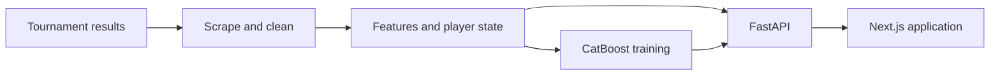

# RateMyRacket

**Racketlon analytics, player ratings, and match predictions.**

RateMyRacket turns tournament results into an interactive application for comparing players and predicting matches across table tennis, badminton, squash, and tennis. Racketlon combines these four sports into a single match decided by total points.

Built by **Zain Magdon-Ismail**, the project covers data collection, feature engineering, model training, API development, and a responsive web interface.

[Visit the app](https://ratemyracket.com) · [Read the research paper](frontend/public/paper.pdf)

## What you can do

- **Predict a matchup:** compare two players and see estimated scores for each sport and the overall result.
- **Explore player profiles:** view ratings, ranks, tournament results, and match history.
- **Compare head-to-head results:** inspect previous meetings between two players.
- **Browse leaderboards:** filter overall and sport-specific rankings by gender.
- **Save favorites:** keep a personal shortlist in browser local storage, without an account.

Password-protected administration endpoints support adding and deleting match results and refreshing the data pipeline.

## Engineering highlights

| Area | Implementation |
| --- | --- |
| Data ingestion | Python scrapers collect TournamentSoftware and Jacketlon results, with incremental updates and historical backfills. |
| Data quality | Cleaning normalizes results, applies player identity corrections and match exclusions, and merges records with deduplication. |
| Feature engineering | Sport-specific ratings, recent form, inactivity, long-term performance, and head-to-head history represent each matchup. |
| Modeling | CatBoost models estimate score differences and totals, with residual correction and score reconstruction for each sport. |
| API | FastAPI exposes player search, profiles, leaderboards, match history, and predictions; model and rating caches support repeated requests. |
| Frontend | Next.js App Router, React, TypeScript, and Tailwind CSS power the player and prediction interfaces. |
| Operations | Docker packages the API and pipeline worker; Cloudflare R2 stores pipeline data, and the worker runner supports scheduled updates, locking, and failure emails. |

## How it works



The pipeline produces cleaned match records, training features, player inference state, and a packaged predictor. The API reads those files to serve ratings and predictions. Favorites are stored on the client; the application does not require a relational database.

The project's published results report **73.4% winner accuracy** and approximately **14 points mean absolute error** for the overall score difference. These are the results presented in the [project overview](frontend/app/about/page.tsx), rather than a live benchmark of every retrained model. The [research paper](frontend/public/paper.pdf) describes the methodology and results. Ratings are estimates, and predictions for players with limited match history are less reliable.

## Explore the code

| Location | What to look for |
| --- | --- |
| [frontend/app](frontend/app) | Prediction, player profile, leaderboard, and favorites pages |
| [backend/app/api](backend/app/api) | Public API routes and protected administration routes |
| [backend/ml/features.py](backend/ml/features.py) | Player state and matchup feature construction |
| [backend/ml/models/catboost/catboost_fin.py](backend/ml/models/catboost/catboost_fin.py) | Training, evaluation, predictor packaging, and score reconstruction |
| [backend/ml/pipeline.py](backend/ml/pipeline.py) | Scraping, cleaning, feature generation, and retraining orchestration |
| [backend/ml/tests](backend/ml/tests) | Scraper conversion and data-cleaning regression tests |
| [docker](docker) | Container definitions and scheduled worker tooling |

## Run locally

Use **Python 3.13** (the version used by the Docker images) and **Node.js 20.9 or later** with npm. Run the backend commands from `backend/` because runtime paths are relative to that directory.

### 1. Backend dependencies

```sh
cd backend
python -m venv .venv
```

Activate the environment with `.venv\Scripts\Activate.ps1` in Windows PowerShell, or `source .venv/bin/activate` on macOS/Linux. Then install dependencies:

```sh
python -m pip install -r requirements.txt
```

### 2. Data and model artifacts

A fresh checkout needs runtime artifacts before the API can start. The expected locations, relative to `backend/`, are:

```text
ml/data/inference_state.pkl
ml/data/matches_cleaned.csv
ml/data/tournament_mapping.csv
ml/models/catboost/artifacts/predictor_package/
    models.pkl
    feature_cols.json
    inference_state.pkl
    metadata.json
```

Use a compatible set of existing artifacts, or build them by running the historical pipeline:

```sh
python -m ml.pipeline --full
```

This command contacts external tournament sources and trains the models; a full backfill can take substantial time. Subsequent updates use `python -m ml.pipeline`. Restart the API after local retraining to load the updated files. Only load pickle artifacts from a trusted source.

Cloudflare R2 is optional for local development with artifacts already on disk. Deployment settings and worker configuration are documented in [docker/README.md](docker/README.md). Keep credentials in ignored environment files. Admin operations require the corresponding `ADMIN_SECRET_KEY`, `UPLOAD_PASSWORD`, or `DELETE_PASSWORD`; browsing and predictions do not require these secrets.

### 3. Start the API

From `backend/`, with the environment active:

```sh
python -m uvicorn app.main:app --reload --host 127.0.0.1 --port 8000
```

The API is available at <http://127.0.0.1:8000>, with interactive documentation at <http://127.0.0.1:8000/docs>.

### 4. Start the frontend

In a second terminal, from the repository root:

```sh
cd frontend
npm ci
npm run dev
```

Open <http://localhost:3000>. The frontend defaults to the local API at `http://127.0.0.1:8000`. To use another backend, set `NEXT_PUBLIC_API_URL` in `frontend/.env.local`.

## Development checks

Run the existing data-pipeline tests from `backend/`:

```sh
python -m unittest discover -s ml/tests -v
```

From `frontend/`, run `npm run lint` and `npm run build` to check the web application.
